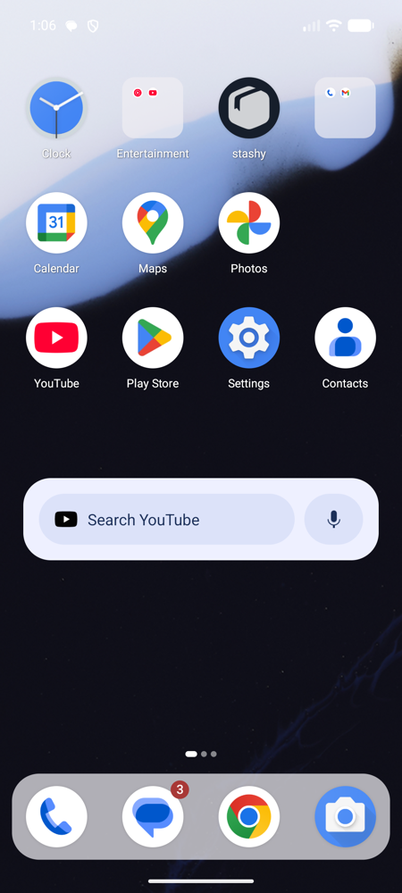
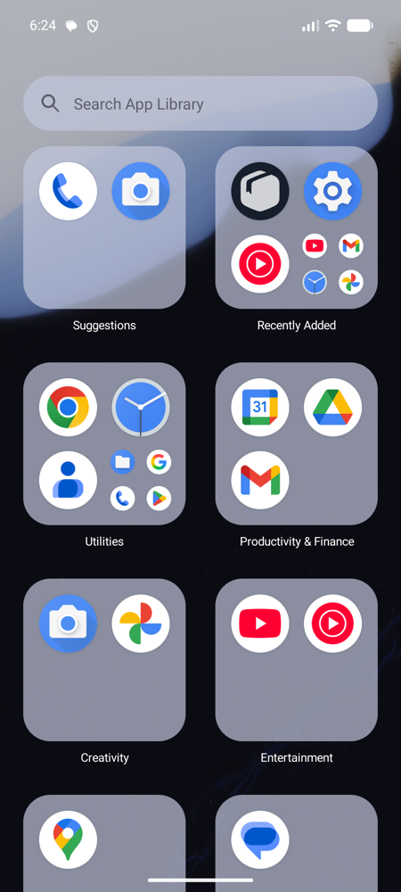
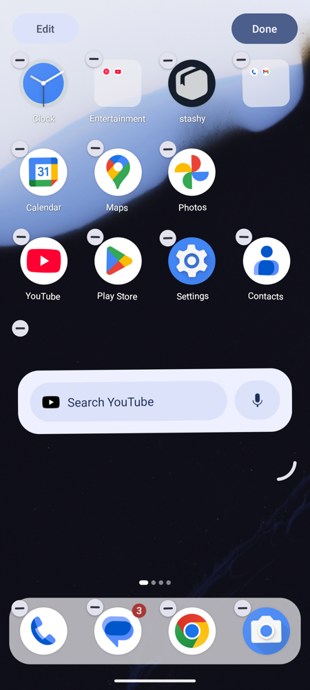
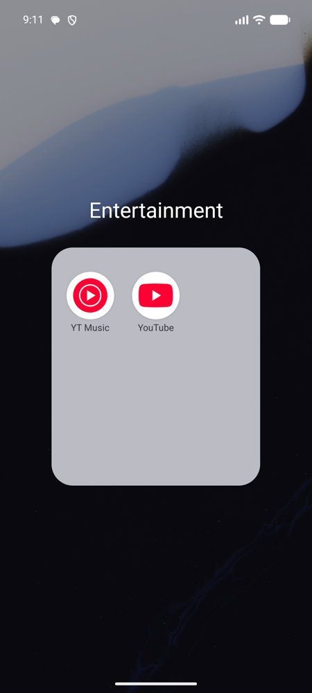
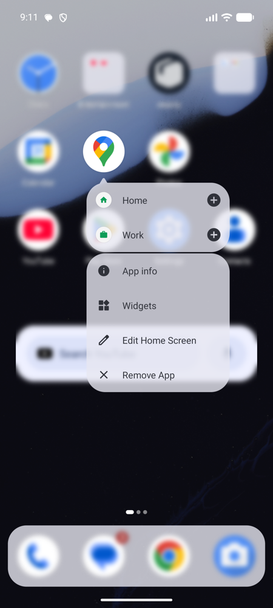
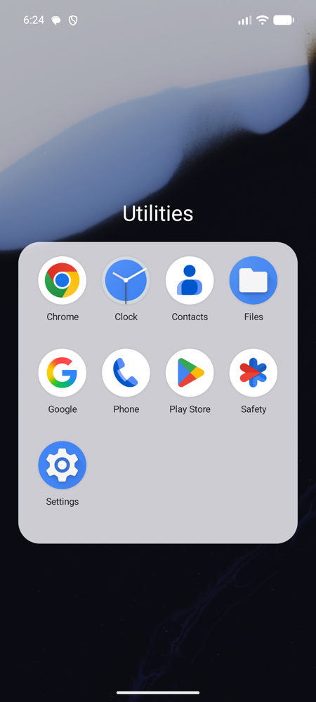
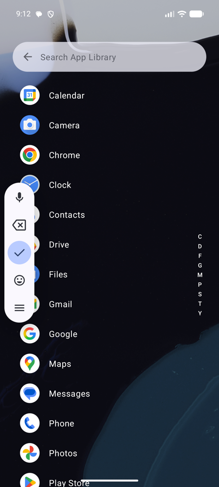
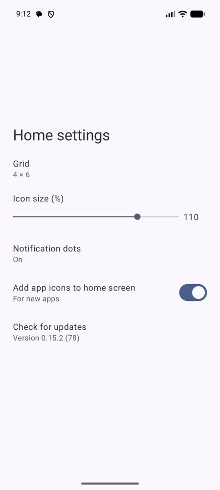

# letzgo launcher

An Android home screen app built on AOSP Launcher3 that **works like the iOS home screen** but
**looks like Material 3**: dynamic colors from your wallpaper, tonal surfaces, M3 shapes, menus and
dialogs. No app drawer, no Google search bar – instead an App Library, jiggle mode and a default page
of your choice.

<p>
  
  
  
  
</p>

## Features

### Home screen
- iOS-style grid (4 × 6 by default; 4 × 5, 5 × 6 and 5 × 7 in settings) with an adjustable icon
  size (80–120 %, default 110 %). The dock follows the grid (4 or 5 slots) and sits in a
  translucent capsule.
- The home screen is a *selection* of your apps – every app always lives in the App Library.
  Newly installed apps can be added to the home screen automatically (setting).
- Folders show a 3 × 3 preview, open centered with their name above them and are named after
  the App Library category of their apps.
- Red numeric notification badges.
- Swipe down on the left half for notifications, on the right half for quick settings.

### Edit mode (“jiggle mode”)


- Long-press empty space, drag any icon or choose *Edit Home Screen* in a context menu.
- Icons, folders and widgets wiggle and show a minus badge to remove them (apps can be removed
  from the home screen or uninstalled). Widgets get a corner handle to resize them.
- *Edit* opens: wallpaper & style, widgets, home settings and **Edit Pages**.
- Page overview: reorder or delete pages (their apps stay in the App Library), tap a page to make
  it the **default page** (shown at start and when pressing home) and **Add Page**. Tap the page
  dots to get there directly.
- *Done*, back or tapping empty space leaves edit mode.

<br clear="right">

### Context menus


- Long-press an app, folder or widget for an anchored M3 menu; the rest of the home screen
  blurs.
- Widgets offer **Small / Medium / Large** (iOS sizes 2 × 2, 4 × 2, 4 × 4 – only the sizes the
  widget supports).

<br clear="right">

### App Library
<p>
  
  
  
</p>

- Swipe left past the last page. Apps are grouped into tiles: **Suggestions** (most used, counted
  on device), **Recently Added** and categories (Utilities, Social, Productivity & Finance,
  Creativity, Entertainment, Information & Reading, Travel, Shopping & Food, Health & Fitness,
  Games, Other).
- Tap an app to launch it, tap the small icons to open the whole category like a folder.
- Drag an app out to place it on the home screen.
- Search: tap the search bar or swipe down. Alphabetical list with an A–Z index above the
  keyboard; back closes the search.
- **How categories are chosen:** your own choice (*Change Category* in the context menu) → a list
  of ~150 well-known apps → the category the app declares → keywords in package name and title →
  *Other*.

### Settings and updates


- Grid, icon size, notification badges, adding new apps to the home screen.
- Release builds check GitHub for a new version (at most every six hours), download it in the
  app, verify the SHA-256 checksum and hand it to the package installer. *Check for updates* in
  settings does the same on demand.
- The launcher is English only.

<br clear="right">

## Install

Download the latest APK from [Releases](https://github.com/1letzgo/letzgo-launcher/releases),
install it and choose **letzgo** as the default home app (Android settings → Apps → Default apps,
or *Set as default* in the launcher settings). Requires Android 14 (API 34) or newer.

## Build

Requirements: JDK 21 or newer (tested with JDK 25) and the Android SDK with platform 37.1 (AGP
downloads it when the license is accepted).

```sh
./gradlew :app:assembleDebug
adb install -r app/build/outputs/apk/debug/app-debug.apk
```

Debug builds don't check for updates.

## Releases

```sh
tools/release.sh "What's new"
```

builds the release APK and publishes it as a GitHub release `launcher-android-<versionCode>`,
which the in-app updater picks up.

- `versionCode` is the number of commits, `versionName` is `letzgoVersionName` in
  `gradle.properties`.
- Release builds are shrunk with R8 (Launcher3's `proguard.flags` plus `app/proguard-rules.pro`),
  which takes the APK from about 65 MB to about 7 MB. Code that is only reached via reflection
  needs a keep rule there.
- Release APKs are signed with the debug key of the build machine (`~/.android/debug.keystore`).
  It must never change, otherwise Android rejects the updates.

## Project layout

| Directory | Contents |
|---|---|
| `aosp/` | AOSP snapshot (git subtree of branch `aosp/<tag>`), with a few marked patches |
| `app/` | App module: builds Launcher3 from `aosp/Launcher3` (without Quickstep), own manifest, own code in `de.letzgo.launcher`, own resources in `app/src/main/res` (they override Launcher3's) |
| `flags/` | aconfig flags as Java classes, generated by `buildSrc/GenerateAconfigFlags.kt` |
| `compat/` | Stubs for `frameworks/base` classes that are not in the snapshot |
| `systemui/*` | Libraries from `frameworks/libs/systemui` (iconloader, animation, dynamiccolors, usertype) |
| `launcher/*` | Launcher3 modules: protos, widget picker, app functions |

Our own code (`app/src/main/java/de/letzgo/launcher`):

| Package | Contents |
|---|---|
| `LetzgoLauncher` | Activity: panels, gestures, backdrop, dock, folder title, popups |
| `edit/` | Edit mode, minus badges, resize handle, edit bar, page overview, default page |
| `panels/` | App Library, categories, side panel base and swipe controller |
| `popup/` | Context menu entries (edit home screen, remove app, widget sizes) |
| `settings/` | Settings additions (grid, icon size, default home, updates) |
| `model/` | Home screen app selection, app usage for suggestions |
| `ui/` | M3 helpers, dock capsule, backdrop, folder title, menus, search bar, letter index |
| `update/` | GitHub release check and in-app update |

### aconfig flags

AOSP generates `Flags` classes with the `aconfig` tool. Here the Gradle task `generateFlags` in the
`flags` module does that. Values match the AOSP release config (for android-17.0.0_r1: `cp1a`)
and live in `flags/release-values.properties`, generated with

```sh
tools/import_flag_values.py android-17.0.0_r1 cp1a
```

Own overrides go into `flags/overrides.properties`; flags not listed are off. Platform flags from
`frameworks/base` are hidden API on devices, so Launcher3 references them through
`de.letzgo.launcher.fwflags.*` (stub declarations in `flags/aconfig/`).

### Resources

Some AOSP resources reference private framework resources (`@androidprv:`) and non-public
`@android:color/system_*` colors. The `PublicizeResources` task (buildSrc) copies the resources of
Launcher3 and dynamiccolors to `build/generated/res` and maps those references to public colors.
Resources in `app/src/main/res` are registered after them and take precedence.

### Patches to `aosp/`

Every behavior change in Launcher3 is gated by a `BuildConfig` flag (see `app/build.gradle.kts`):

| Flag | Effect | Files |
|---|---|---|
| `ALL_APPS_ENABLED=false` | No app drawer entry | `popup/WorkspaceLongPressOptions.kt` |
| `SPRING_LOADED_SHRINK=false` | Home screen keeps its size while dragging; screen edge flips pages | `states/SpringLoadedState.java`, `Workspace.java` |
| `FOLDER_PREVIEW_GRID` | 3 × 3 folder preview | `folder/ClippedFolderIconLayoutRule.java`, `folder/FolderGridOrganizer.java` |
| `FOLDER_ROUNDED_SQUARE` | Folders as rounded squares | `graphics/ThemeManager.kt` |
| `FOLDER_TITLE_ABOVE` | Folder name above the open folder | `folder/Folder.java` |
| `FOLDER_CATEGORY_NAMES` | Name new folders after their category | `folder/FolderNameProvider.java` |
| `NUMERIC_BADGES` | Red count badges instead of dots | `BubbleTextView.java`, `folder/FolderIcon.java`, `DotRenderer.java` |
| `WIDGETS_ALIGN_TO_ICONS` | Widgets end flush with the icons | `deviceprofile/WorkspaceProfileNonResponsiveFactory.kt` |
| `WIDGETS_IOS_SIZES` | New widgets start in iOS sizes | `widget/LauncherAppWidgetProviderInfo.java` |
| `LETZGO_POPUPS` | Own context menu entries (sizes, edit, remove) | `popup/PopupDataSource.kt` |
| `STABLE_STATUS_BAR_INSET` | Hidden status bar in edit mode doesn't move the grid | `util/window/WindowManagerProxy.java` |
| `ICON_SIZE_SETTING` | Icon size factor from settings | `InvariantDeviceProfile.java` |
| `GRID_MIGRATION_KEEP_SPANS` | Grid changes keep widget sizes, no shifting; 5 × 7 grid | `model/GridSizeMigrationLogic.kt`, `model/GridMigrationOption.kt`, `DeviceProfile.java` |
| – | Default page for start and home button | `Workspace.java` (`moveToDefaultScreen`) |

Not a patch, but good to know: swiping down uses `StatusBarManager.expandNotificationsPanel()` /
`expandSettingsPanel()` via reflection (`de.letzgo.launcher.system.SystemPanels`).

### Updating AOSP

1. Put the tag into `aosp-tag.txt` (empty = latest) and push; the `import-aosp.yml` workflow stores
   the snapshot on branch `aosp/<tag>`.
2. `git fetch && git subtree merge --prefix=aosp --squash origin/aosp/<tag>`
